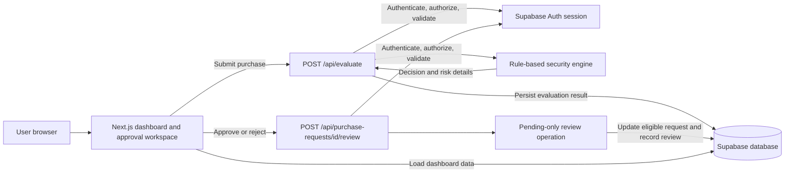

# PROOFPAY AI — Project and Hackathon Documentation

## 1. Abstract

PROOFPAY AI is a hackathon prototype for evaluating purchase requests and
presenting them to a human reviewer. It combines a deterministic rule engine,
authenticated API routes, a Supabase-backed dashboard, and a pending-only
approval workflow. The prototype demonstrates how purchase data can be
structured, flagged, and reviewed; it is not a production payment-security
service.

## 2. Problem Statement

Organizations need a consistent way to collect purchase details, identify
requests that need attention, and record a human decision. An unstructured
process can make it harder to understand why a request was flagged or who
reviewed it. This project demonstrates a simple, auditable workflow for that
problem.

## 3. Existing Approaches and Their Limits

Common approaches include manual review, static policy rules, and specialized
third-party fraud services. Manual review can be time-consuming; static rules
can miss context or produce false positives; and a third-party service needs a
real provider, integration, and validated data before it can make meaningful
claims.

PROOFPAY AI currently uses only static demo rules. It does not integrate with a
merchant verification provider, payment processor, or machine-learning fraud
service.

## 4. Proposed Solution

Collect a purchase request, validate its fields, calculate a demo risk result,
and require an authorized human to decide eligible requests. Keep the computed
result and review information available to the dashboard. Evaluation is
separate from approval, and approval is separate from payment execution.

## 5. Objectives

- Provide a clear purchase-evaluation and human-review demonstration.
- Apply the same explicit rules to each valid request.
- Send uncertain, mismatched, or higher-value requests to review.
- Require authenticated admin access for protected evaluation and review
  actions.
- Record the reviewer decision through the existing Supabase review workflow.
- Clearly disclose that merchant identity rules are demo-only.

## 6. Project Scope

**Included:** login/session integration, dashboard reporting, purchase
evaluation, demo merchant-name/domain matching, approval workspace, approval
and rejection actions, review metadata, and isolated automated tests.

**Not included:** real merchant verification, machine-learning inference,
payment authorization or execution, production fraud guarantees, live
third-party risk feeds, or verified production Supabase configuration.

## 7. Technology and System Requirements

| Area | Technology |
|---|---|
| Web application | Next.js 16.4.5, React 19.3 |
| Language | TypeScript 5 |
| Styling | Tailwind CSS 4 |
| Authentication and data | Supabase |
| Automated tests | Node.js built-in `node:test` runner |
| Recommended runtime | Node.js 24 |

Install dependencies with `npm ci`. Configure the environment variables listed
in [the README](./README.md) using values from a development Supabase project.

## 8. Architecture



The diagram describes the application flow. The tests use isolated mocks and do
not verify deployed Supabase grants, row-level security, or production
configuration. There is no payment provider or payment execution path in the
demonstrated workflow.

## 9. Application Modules

- **Dashboard:** summarizes purchase request and risk information from
  Supabase.
- **Approval Workspace:** presents requests awaiting human decisions and
  provides optional review notes.
- **Evaluation API:** authenticates and validates a request, calls the shared
  security engine, and persists the computed evaluation state.
- **Security engine:** deterministic merchant identity, currency, amount, and
  input checks.
- **Review API and database operation:** authorizes a human decision and
  prevents a previously decided or otherwise ineligible request from being
  reviewed again.
- **Supabase integration:** supplies user sessions and application data.

## 10. Main Workflows

### Evaluate a purchase

1. An authenticated admin submits merchant, domain, product, amount, and
   currency.
2. The API checks the request origin, authentication, role, content, and field
   constraints.
3. The API calls `evaluatePurchase()` from the security engine.
4. The computed result is saved as a request for human review; invalid requests
   are rejected or blocked according to the existing route and engine
   validations.
5. The dashboard refreshes to show the persisted result.

### Review a purchase

1. An authenticated admin chooses Approve or Reject and may add a note.
2. The review API checks origin, identity, authorization, and input.
3. The protected database operation accepts only an eligible pending request
   and records the reviewer decision.
4. The dashboard refreshes and displays the updated information.

The word “Approve” is a human review decision for the request. It does **not**
initiate or execute a payment.

## 11. Security Model

- Protected API routes require an authenticated user and the expected admin
  role in trusted user metadata.
- Routes validate the configured application origin and reject missing or
  mismatched origins.
- Request fields and body size are validated before evaluation or review.
- The review API ignores a client-supplied actor ID and passes the ID from the
  authenticated admin session. The current service-role-only database function
  accepts that ID as an argument and does not independently bind it to the
  caller, so this protection currently depends on the trusted server route.
- The database review operation is pending-only and records review activity.
- Environment secrets must remain server-side; never expose
  `SUPABASE_SECRET_KEY` using a `NEXT_PUBLIC_` variable.
- The evaluation route does not accept a client-provided approval decision as
  an instruction to approve or execute payment.

These are source-code and isolated-test observations. Deployed Supabase access
grants, RLS policies, production secret configuration, and live authorization
behavior have not been independently verified. Database-side reviewer identity
hardening and live verification remain blocked until a separate staging project
is available.

## 12. Demo Rules and Decision Behavior

### Controlled demo identities

| Normalized name | Configured demo domain |
|---|---|
| `amazon` | `amazon.com` |
| `walmart` | `walmart.com` |
| `best buy` | `bestbuy.com` |

Merchant names are trimmed, lowercased, and internal whitespace is collapsed.
Domains are lowercased and trimmed; a leading `www.` and one trailing dot are
removed. A request is trusted by this demo rule only when both normalized
values match a configured pair. This mapping does not establish real-world
merchant identity and does not detect every lookalike or Unicode domain.

### Risk and decision rules

For supported-currency, valid requests, the score is:

```text
min(100, 10
  + 45 when the configured merchant name/domain pair does not match
  + 30 when amount > $500
  + 15 when amount > $1,000)
```

- Invalid or incomplete purchase information: `BLOCKED`, score 100.
- Currency other than `USD`: `REVIEW_REQUIRED`, score 60.
- Name/domain mismatch or amount above $500: `REVIEW_REQUIRED`.
- Matching configured identity and amount at or below $500:
  `READY_FOR_HUMAN_APPROVAL`, score 10.
- For review decisions, scores at or above 70 are `HIGH`; lower review scores
  are `MEDIUM`. A matching identity within the amount limit is `LOW`.
- A high risk score never creates automatic approval.
- Even `READY_FOR_HUMAN_APPROVAL` means “wait for a human,” not “approved.”

The $500 and $1,000 comparisons are strict `>` checks. The score formula is a
demo heuristic and is not calibrated against real fraud outcomes.

## 13. Data Model and Audit Information

The application uses existing Supabase purchase-request data for request
details and evaluation results. The review migration updates only eligible
pending requests and records the review action in the existing approval-event
audit table, including reviewer/action information and the optional note.

No schema change was made during the security test work described here. This
document intentionally does not reproduce a full database schema. Confirm the
actual migration state, table grants, and RLS policies in the target Supabase
project before deployment.

## 14. API Surface

| Endpoint | Purpose | Important boundary |
|---|---|---|
| `POST /api/evaluate` | Validate and evaluate a purchase request | Authenticated/admin and origin checks; computes using the shared engine; does not execute payment |
| `POST /api/purchase-requests/[id]/review` | Approve or reject an eligible request | Authenticated/admin and origin checks; pending-only review operation |

The exact response fields and status codes are defined by the route handlers;
clients should use those implementations as the source of truth.

## 15. Local Configuration and Safe Data Handling

Required environment variable names:

- `NEXT_PUBLIC_SUPABASE_URL`
- `NEXT_PUBLIC_SUPABASE_PUBLISHABLE_KEY`
- `SUPABASE_SECRET_KEY` (server-only)
- `APP_ORIGIN`

Use your own development Supabase project. Keep `.env.local` out of source
control, do not paste secret values into tickets or screenshots, and do not use
real customer data for test fixtures. The repository ignores `.env*`, but
confirm repository tracking status in a Git-enabled environment before
publishing.

## 16. Testing and Verification

Automated tests run with Node's built-in test runner:

```bash
node --test tests/security-engine.test.ts tests/evaluate-api.test.ts tests/purchase-review-api.test.ts tests/purchase-workflow.e2e.test.ts
```

The latest recorded test result is **99 passed, 0 failed**:

- 29 security-engine tests
- 48 evaluation API tests
- 15 purchase-review API tests
- 7 mocked workflow tests

Additional recorded checks:

- `npx.cmd tsc --noEmit`: passed.
- `npm.cmd run lint`: passed.
- `npm.cmd run build`: passed.
- `npm.cmd audit --omit=dev --audit-level=moderate`: no production dependency
  vulnerabilities reported.

The full dependency audit reported **7 moderate findings in development
dependencies**, in the `minimatch` dependency chain used by
`@typescript-eslint/typescript-estree`. No dependency update was applied; review
the current lockfile and advisory before deciding on an update. The tests are
isolated and mock-backed; they do not prove live database behavior.

## 17. Deployment Checklist

Before any deployment:

- Use a supported Node.js version and install from `package-lock.json`.
- Configure the Supabase URL and publishable key, server-only secret, and
  exact production `APP_ORIGIN` in the hosting provider's secret manager.
- Confirm production auth redirect URLs, admin-role assignment, database
  migrations, grants, and RLS policies in the target Supabase project.
- Ensure all externally reachable routes use HTTPS and production secrets are
  not exposed in client bundles or logs.
- Run the test, type-check, lint, build, and dependency-audit commands against
  the release candidate.
- Test authorized and unauthorized flows using a dedicated non-production
  account and synthetic data.
- Confirm there is no payment provider or automatic payment execution enabled
  before describing the product to users.
- Monitor deployment logs and define an incident-response and rollback plan.

No deployment was performed as part of this project work. Production Supabase
configuration and live customer behavior remain unverified.

## 18. Known Limitations and Risks

- Rule-based demo only; no AI/ML fraud model is implemented.
- Merchant mapping is not live verification and does not prevent every
  spoofed, lookalike, Unicode, or compromised-domain scenario.
- `USD` is the only supported currency in the demo rules.
- Risk scores and amount thresholds are illustrative, not statistically
  validated.
- API tests and lifecycle tests use isolated mocks; no live Supabase integration
  test was run.
- The review RPC does not independently verify the supplied actor UUID. The
  authenticated API supplies the correct ID for browser requests, but any
  trusted service-role caller can pass a different ID; hardening is pending.
- Authenticated dashboard screens were not visually tested in a browser.
- Effective deployed database grants, RLS, auth settings, and environment
  configuration were not verified.
- The full npm audit reports 7 moderate development-dependency findings; the
  production-only audit reports zero.
- Payment initiation, settlement, refunds, and chargebacks are outside project
  scope.

## 19. Future Work and Responsible AI Readiness

Recommended next steps, subject to separate review:

1. Resolve or formally accept the moderate development-dependency advisories.
2. In a dedicated staging project, verify Supabase RLS, grants, migration
   state, secret rotation, and origin/redirect configuration; implement and
   verify database-side reviewer identity hardening there before considering
   production database changes.
3. Add staging integration tests that use synthetic data and disposable
   accounts.
4. Replace the demo merchant mapping only when a real, documented verification
   source is selected and its failure modes are understood.
5. If adding AI, use it only to summarize evidence or suggest review questions.
   Keep deterministic policy checks, show evidence and uncertainty, log model
   outputs, protect personal data, and require a human decision.
6. Never allow an AI model or this demo engine to automatically approve or
   execute payments.

These are recommendations, not implemented features.

## 20. Hackathon Demonstration Outline

Suggested five-minute walkthrough:

1. **Problem and boundaries (30 seconds):** explain that this is a review
   assistant prototype, not a live payment-security product.
2. **Dashboard (45 seconds):** show the request and risk summaries using a
   dedicated demo account and synthetic records.
3. **Evaluation (90 seconds):** demonstrate a matching demo identity at or below
   $500 and a mismatched or higher-value request.
4. **Approval Workspace (90 seconds):** inspect the pending item, add an
   optional note, and explicitly approve or reject it as the authenticated
   reviewer.
5. **Security and tests (45 seconds):** show the isolated tests, protected
   review path, and the difference between evaluation and payment execution.
6. **Limitations and roadmap (40 seconds):** disclose no ML, no live merchant
   verification, no payment execution, and the need for deployment-specific
   Supabase verification.

Do not show real customer data, secret values, or production credentials during
the presentation.

## 21. Judge Questions and Glossary

### Likely questions

**Is this really AI-powered today?**  
No. The current decision engine is a deterministic TypeScript ruleset. “AI” is
the project name; no machine-learning model is used.

**Does the allowlist verify Amazon, Walmart, or Best Buy?**  
No. It is a controlled demo mapping of names to domains and is not connected to
any merchant verification service.

**Does `READY_FOR_HUMAN_APPROVAL` approve the purchase?**  
No. It means the request can proceed to explicit human review. The purchase
remains unapproved until an authorized reviewer acts.

**Does approving a request execute payment?**  
No. There is no payment processor integration or payment execution path in this
prototype.

**Are the tests against a live Supabase database?**  
No. Protected API and workflow tests use isolated in-memory mocks. Deployed
Supabase policies and grants must be checked separately.

### Glossary

- **Admin:** authenticated user with the required trusted admin role.
- **Demo mapping:** fixed name/domain pairs used only by the local ruleset.
- **Human approval:** explicit approve/reject decision by an authorized person.
- **Risk score:** heuristic numeric indicator from the demo rules, not a
  probability of fraud.
- **RLS:** Supabase row-level security policies that control database row
  access.
- **Synthetic data:** invented test records that do not identify real people
  or customers.
