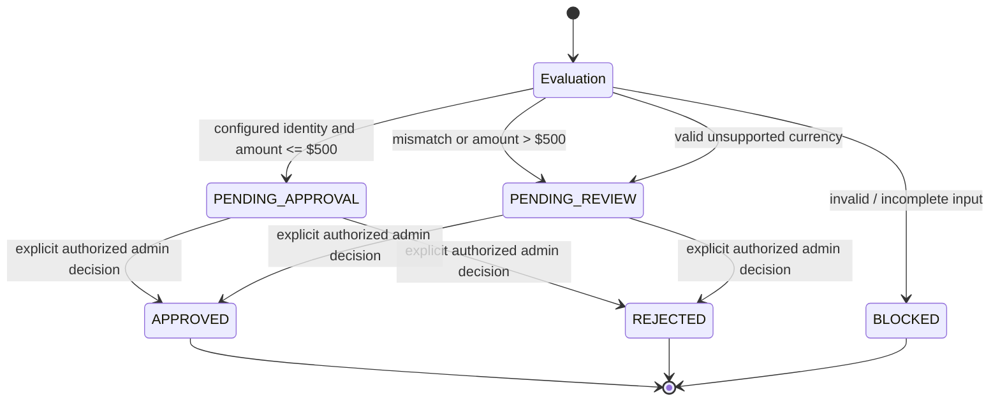

# PROOFPAY AI — System Architecture

## Overview

PROOFPAY AI is a Next.js web application for evaluating purchase requests and
presenting them for human review. Its security engine is a deterministic
TypeScript ruleset. It is not a machine-learning system, a real-world merchant
verification service, or a payment processor.

## Components

### Browser interface

- The login page signs in through the Supabase browser client and checks the
  trusted `app_metadata.role` value for the admin role.
- The dashboard is a server-rendered page. Its interactive client component
  presents request summaries, the evaluation form, and a separate Approval
  Workspace.
- The browser uses the Supabase publishable key. It does not import the
  service-role helper.

### Authentication and authorization

- Dashboard access is checked server-side using the Supabase session and
  trusted admin metadata.
- Both protected POST APIs independently call `auth.getUser()` and require
  `app_metadata.role === "admin"`.
- The evaluation and review APIs require a configured canonical `APP_ORIGIN`,
  reject a missing or mismatched request origin, and validate request data
  before their privileged database operation.

### Evaluation API and security engine

`POST /api/evaluate` validates the JSON body, field types, lengths, amount, and
currency format. It calls the shared TypeScript `evaluatePurchase()` function
and persists the computed result using the server-only Supabase admin client.

Current demo behavior:

- The configured name/domain pairs are Amazon/`amazon.com`,
  Walmart/`walmart.com`, and Best Buy/`bestbuy.com`. Matching is only a
  controlled demo rule; it does not establish merchant ownership.
- The engine can classify invalid/incomplete purchase data as blocked. In the
  API flow, malformed, missing, or out-of-range fields are rejected before
  evaluation and are not persisted as blocked requests.
- A valid currency other than USD returns `REVIEW_REQUIRED`; the engine does
  not apply its USD amount-score calculation to that request.
- For USD, the score starts at 10, adds 45 for a name/domain mismatch, 30 when
  the amount is over $500, and 15 when it is over $1,000, capped at 100.
- A matching configured identity at or below $500 is
  `READY_FOR_HUMAN_APPROVAL`, with a `PENDING_APPROVAL` status.
- A mismatch or amount over $500 is `REVIEW_REQUIRED`, with a
  `PENDING_REVIEW` status.
- A high score is not a fraud finding, and a low score is not approval.

The evaluation route inserts the request details, computed risk fields,
reasons, next action, and pending/blocked status into `purchase_requests`.

### Review API and database operation

`POST /api/purchase-requests/[id]/review` checks the session, admin role,
canonical origin, UUID request ID, body size, action, and optional note. The
browser sends an action and note; the API takes the reviewer ID from the
authenticated user session rather than accepting one from the browser.

The route calls the existing `review_purchase_request` Supabase RPC with the
server-only service-role client. The local migration defines a pending-only
operation: it changes a request only if its status is
`PENDING_APPROVAL` or `PENDING_REVIEW`, records review fields, and inserts an
`approval_events` record. A request no longer pending is not reported as a
second successful decision.

**Unresolved reviewer identity limitation:** the current RPC accepts
`p_actor_id` and does not independently verify it against the database caller.
The API supplies the authenticated admin's ID for normal browser requests, but
a trusted service-role caller could supply another ID. Database-side identity
hardening has not been applied.

### Supabase clients and database

- The session client uses the Supabase publishable key and request cookies to
  read the authenticated user.
- The server-only admin client uses `SUPABASE_SECRET_KEY`.
- The server-rendered dashboard uses the admin client to read purchase
  requests and calculate counts.
- The evaluation API uses the admin client to insert evaluation results.
- The review API uses the admin client to call the review RPC.

These are source-code paths. The actual grants, RLS policies, migration state,
and production configuration have not been independently verified in a
separate staging project. Do not interpret the diagram as proof of live
database security.

## Data flow

1. An admin signs in through Supabase Auth.
2. The server verifies the session and trusted admin role before rendering the
   dashboard or allowing protected API operations.
3. The admin submits synthetic purchase fields from the evaluation form.
4. The evaluation API validates the request, runs deterministic rules, and
   inserts the computed result into `purchase_requests`.
5. The dashboard refreshes and shows the new pending/blocked request and
   summary counts.
6. In the Approval Workspace, an admin optionally adds a note and explicitly
   approves or rejects a pending request.
7. The review API validates the operation and invokes the pending-only RPC.
   The RPC updates review fields and records an approval event.
8. The dashboard refreshes to show the decision and review metadata.

There is **no payment execution step** in this flow.

## Human approval workflow



`APPROVED` means a human recorded approval of the request in this prototype. It
does not mean that a payment was authorized, submitted, or completed.

## Architecture diagram

```mermaid
flowchart LR
    Admin[Authorized admin]
    Browser[Browser UI<br/>Login, Dashboard, Approval Workspace]
    DashboardPage[Next.js server-rendered dashboard]
    BrowserClient[Browser Supabase client<br/>publishable key]
    ServerSession[Next.js server session client<br/>publishable key + request cookies]
    Auth[Supabase Auth<br/>user session + trusted app_metadata role]
    EvalAPI[POST /api/evaluate]
    ReviewAPI[POST /api/purchase-requests/[id]/review]
    Engine[Deterministic TypeScript<br/>rule-based security engine]
    AdminClient[Server-only Supabase admin client<br/>SUPABASE_SECRET_KEY]
    Requests[(purchase_requests)]
    Events[(approval_events)]

    Admin --> Browser
    Browser --> BrowserClient
    BrowserClient --> Auth
    Browser -->|purchase details| EvalAPI
    Browser -->|approve / reject + optional note| ReviewAPI
    EvalAPI -->|authenticate, authorize, origin + input checks| ServerSession
    ReviewAPI -->|authenticate, authorize, origin + input checks| ServerSession
    DashboardPage -->|verify admin session| ServerSession
    ServerSession --> Auth
    EvalAPI --> Engine
    Engine -->|decision, risk score/level, reasons| EvalAPI
    EvalAPI -->|server-side insert| AdminClient
    AdminClient --> Requests
    ReviewAPI -->|server-side RPC call; authenticated ID passed by route| AdminClient
    AdminClient -->|pending-only review operation| Requests
    AdminClient -->|review event insert via RPC| Events
    DashboardPage -->|server-side dashboard reads| AdminClient
    DashboardPage -->|rendered dashboard data| Browser
    Browser -.->|no payment integration or execution| NoPayment[No payment processor]
```

The service-role RPC actor-ID relationship shown above is enforced by the
trusted API route, not independently by the current database function. Live
Supabase security validation and database-side reviewer identity hardening
remain incomplete.

## Testing scope and deployment cautions

The documented 99 automated tests use isolated mocks for API and workflow
behavior. They do not prove live Supabase grants, RLS, RPC identity, or
production configuration. Use synthetic data in a separate staging project
for integration verification. No staging project is currently available, so
live database validation remains blocked.
